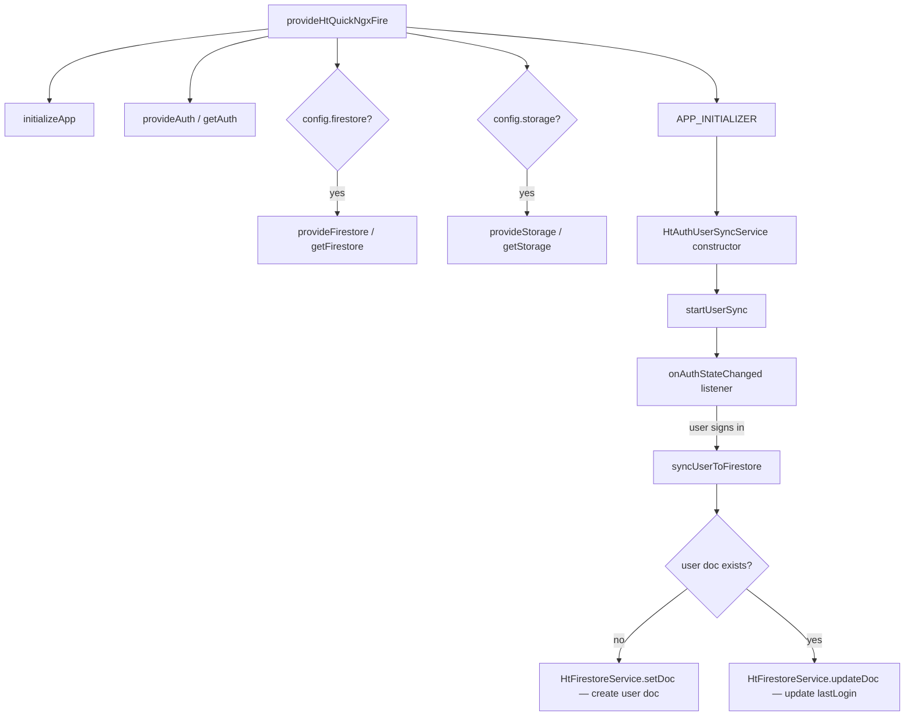
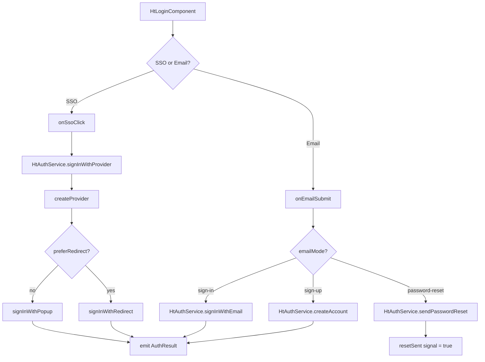
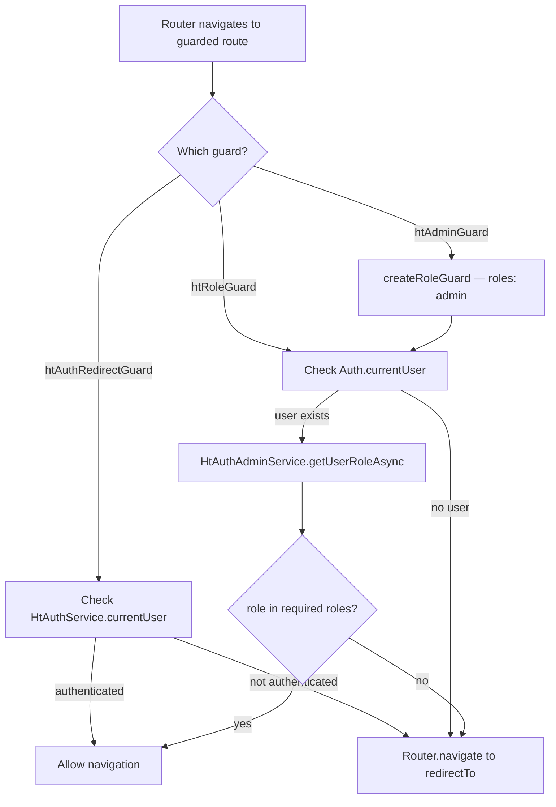
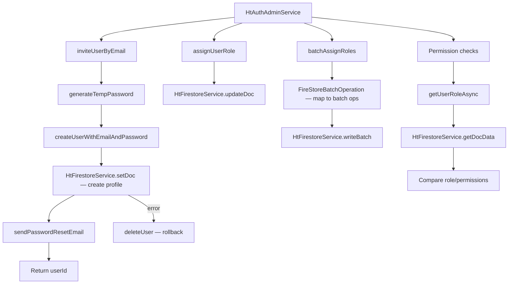
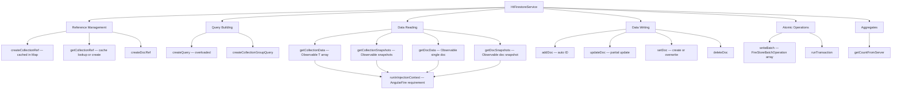
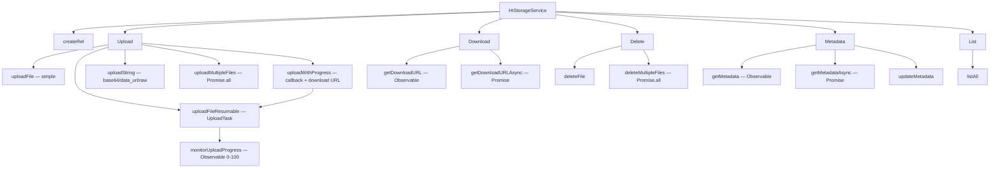

# ht-quick-ngxfire — Complete Library Flow Documentation

## Flow Description

**ht-quick-ngxfire** is an Angular library that wraps Firebase services (Auth, Firestore, Storage) into opinionated, signal-based Angular services. It provides:

1. **Initialization** — A single `provideHtQuickNgxFire()` call that bootstraps all Firebase providers and auto-syncs users to Firestore.
2. **Authentication** — Sign-in (SSO + email/password), account creation, password reset, and a ready-made `<ht-login>` component.
3. **Role-Based Access Control** — User roles/permissions stored in Firestore, with route guards (`htAuthRedirectGuard`, `htRoleGuard`, `htAdminGuard`).
4. **Admin User Management** — Invite users, manage profiles/roles/permissions, batch operations.
5. **Firestore CRUD** — Collection/document reads (Observable streams), writes, batch writes, transactions, and server-side aggregates.
6. **Storage** — File upload (simple, resumable, with progress), download URLs, metadata, and bulk operations.

---

## Flow Diagrams

### 1. Application Initialization Flow

### 2. Authentication & Login Flow

### 3. Route Guard Flow

### 4. Admin User Management Flow

### 5. Firestore CRUD Flow

### 6. Storage Flow

---

## Function List

All functions/methods appearing in the flow diagrams:

**Initialization & Config:**
- `provideHtQuickNgxFire`
- `FIREBASE_CONFIG`
- `AUTH_OPTIONS`

**HtAuthService:**
- `signInWithProvider`
- `signInWithEmail`
- `createAccount`
- `signOut`
- `sendPasswordReset`
- `createProvider` (private)

**HtLoginComponent:**
- `enabledSsoProviders`
- `asInputValue`
- `setEmailMode`
- `onSsoClick`
- `onEmailSubmit`
- `focusErrorContainer` (private)

**HtAuthAdminService:**
- `sendPasswordResetEmail`
- `inviteUserByEmail`
- `generateTempPassword` (private)
- `updateUserPassword`
- `updateUserEmail`
- `updateUserProfile`
- `reauthenticateUser`
- `deleteCurrentUser`
- `assignUserRole`
- `getUserRole`
- `getUserRoleAsync`
- `removeUserRole`
- `updateUserPermissions`
- `addUserPermissions`
- `removeUserPermissions`
- `hasRole`
- `hasPermission`
- `hasAnyPermission`
- `hasAllPermissions`
- `setUserProfile`
- `getUserProfile`
- `updateUserProfileFields`
- `setUserDisabled`
- `getUsersByRole`
- `batchAssignRoles`
- `getCurrentUserRole`
- `isCurrentUserAdmin`
- `currentUserHasPermission`

**HtAuthUserSyncService:**
- `startUserSync` (private)
- `syncUserToFirestore`
- `syncCurrentUser`

**Route Guards:**
- `htAuthRedirectGuard`
- `htRoleGuard`
- `createRoleGuard`
- `htAdminGuard`

**HtFirestoreService:**
- `createCollectionRef`
- `getCollectionRef`
- `createDocRef`
- `createQuery`
- `createCollectionGroupQuery`
- `getCollectionData`
- `getCollectionSnapshots`
- `getDocData`
- `getDocSnapshots`
- `addDoc`
- `updateDoc`
- `setDoc`
- `deleteDoc`
- `writeBatch`
- `runTransaction`
- `getCountFromServer`

**FireStoreBatchOperation:**
- `constructor` (overloaded)

**HtStorageService:**
- `createRef`
- `uploadFile`
- `uploadFileResumable`
- `uploadString`
- `getDownloadURL`
- `getDownloadURLAsync`
- `deleteFile`
- `listAll`
- `getMetadata`
- `getMetadataAsync`
- `updateMetadata`
- `uploadMultipleFiles`
- `deleteMultipleFiles`
- `monitorUploadProgress`
- `uploadWithProgress`

**Models/Interfaces:**
- `FirebaseConfig`
- `AuthOptions`
- `AuthResult`
- `UserRole`
- `UserProfile`
- `AuthRedirectGuardData`
- `RoleGuardData`
- `HtQuickNgxFireError`

---

## Function Reference Table

### Initialization & Configuration

| Function | Description | File |
|----------|-------------|------|
| `provideHtQuickNgxFire` | Bootstrap function that initializes Firebase and all Angular providers | `projects/ht-quick-ngxfire/src/lib/ht-quick-ngxfire.providers.ts:14` |
| `FIREBASE_CONFIG` | InjectionToken for Firebase configuration options | `projects/ht-quick-ngxfire/src/lib/ht-quick-ngxfire.providers.ts:11` |
| `AUTH_OPTIONS` | InjectionToken for authentication provider options | `projects/ht-quick-ngxfire/src/lib/ht-quick-ngxfire.providers.ts:12` |
| `FirebaseConfig` | Interface defining the full library configuration | `projects/ht-quick-ngxfire/src/lib/firebase-config.model.ts:14` |
| `AuthOptions` | Interface defining which auth providers are enabled | `projects/ht-quick-ngxfire/src/lib/firebase-config.model.ts:3` |
| `HtQuickNgxFireError` | Custom error class with optional error code | `projects/ht-quick-ngxfire/src/lib/ht-quick-ngxfire.error.ts:4` |

### Authentication Service (HtAuthService)

| Function | Description | File |
|----------|-------------|------|
| `user$` | Observable stream of the current Firebase Auth user (or null) | `projects/ht-quick-ngxfire/src/lib/auth/ht-auth.service.ts:27` |
| `currentUser` | Signal-based reactive accessor for current user state | `projects/ht-quick-ngxfire/src/lib/auth/ht-auth.service.ts:28` |
| `signInWithProvider` | Sign in with an SSO provider via popup or redirect | `projects/ht-quick-ngxfire/src/lib/auth/ht-auth.service.ts:35` |
| `signInWithEmail` | Sign in with email and password credentials | `projects/ht-quick-ngxfire/src/lib/auth/ht-auth.service.ts:53` |
| `createAccount` | Create a new user account with email and password | `projects/ht-quick-ngxfire/src/lib/auth/ht-auth.service.ts:60` |
| `signOut` | Sign out the current user | `projects/ht-quick-ngxfire/src/lib/auth/ht-auth.service.ts:67` |
| `sendPasswordReset` | Send a password reset email to the given address | `projects/ht-quick-ngxfire/src/lib/auth/ht-auth.service.ts:74` |
| `createProvider` | (Private) Factory that maps provider ID strings to Firebase AuthProvider instances | `projects/ht-quick-ngxfire/src/lib/auth/ht-auth.service.ts:78` |

### Login Component (HtLoginComponent)

| Function | Description | File |
|----------|-------------|------|
| `authOptions` | Required input: which auth providers to display | `projects/ht-quick-ngxfire/src/lib/auth/ht-login.component.ts:352` |
| `authResult` | Output: emits AuthResult after every auth attempt | `projects/ht-quick-ngxfire/src/lib/auth/ht-login.component.ts:353` |
| `enabledSsoProviders` | Computed: filters SSO_PROVIDERS by authOptions flags | `projects/ht-quick-ngxfire/src/lib/auth/ht-login.component.ts:364` |
| `asInputValue` | Extract string value from an input DOM event | `projects/ht-quick-ngxfire/src/lib/auth/ht-login.component.ts:369` |
| `setEmailMode` | Switch the email form between sign-in, sign-up, and password-reset modes | `projects/ht-quick-ngxfire/src/lib/auth/ht-login.component.ts:373` |
| `onSsoClick` | Handle SSO provider button click, delegates to HtAuthService.signInWithProvider | `projects/ht-quick-ngxfire/src/lib/auth/ht-login.component.ts:382` |
| `onEmailSubmit` | Handle email form submission for sign-in, sign-up, or password reset | `projects/ht-quick-ngxfire/src/lib/auth/ht-login.component.ts:410` |
| `focusErrorContainer` | (Private) Focus the error container element for accessibility | `projects/ht-quick-ngxfire/src/lib/auth/ht-login.component.ts:454` |

### Auth Result Model

| Function | Description | File |
|----------|-------------|------|
| `AuthResult` | Interface representing the outcome of an auth operation (success, user, error, isNewUser) | `projects/ht-quick-ngxfire/src/lib/auth/auth-result.model.ts:3` |

### Admin Service (HtAuthAdminService)

| Function | Description | File |
|----------|-------------|------|
| `UserRole` | Interface for role data: role name, permissions, timestamps | `projects/ht-quick-ngxfire/src/lib/auth/ht-auth-admin.service.ts:19` |
| `UserProfile` | Interface for user profile stored in Firestore | `projects/ht-quick-ngxfire/src/lib/auth/ht-auth-admin.service.ts:26` |
| `sendPasswordResetEmail` | Send password reset email with optional action code settings | `projects/ht-quick-ngxfire/src/lib/auth/ht-auth-admin.service.ts:54` |
| `inviteUserByEmail` | Create a user account with temp password and send reset email to invite | `projects/ht-quick-ngxfire/src/lib/auth/ht-auth-admin.service.ts:74` |
| `generateTempPassword` | (Private) Generate a cryptographically random 32-char temporary password | `projects/ht-quick-ngxfire/src/lib/auth/ht-auth-admin.service.ts:118` |
| `updateUserPassword` | Update the current user's password (requires recent auth) | `projects/ht-quick-ngxfire/src/lib/auth/ht-auth-admin.service.ts:133` |
| `updateUserEmail` | Update the current user's email address (requires recent auth) | `projects/ht-quick-ngxfire/src/lib/auth/ht-auth-admin.service.ts:143` |
| `updateUserProfile` | Update current user's displayName and/or photoURL in Firebase Auth | `projects/ht-quick-ngxfire/src/lib/auth/ht-auth-admin.service.ts:153` |
| `reauthenticateUser` | Re-authenticate user with email/password before sensitive operations | `projects/ht-quick-ngxfire/src/lib/auth/ht-auth-admin.service.ts:168` |
| `deleteCurrentUser` | Delete the current user's Firebase Auth account | `projects/ht-quick-ngxfire/src/lib/auth/ht-auth-admin.service.ts:180` |
| `assignUserRole` | Assign a role and optional permissions to a user in Firestore | `projects/ht-quick-ngxfire/src/lib/auth/ht-auth-admin.service.ts:194` |
| `getUserRole` | Get user's role document as an Observable | `projects/ht-quick-ngxfire/src/lib/auth/ht-auth-admin.service.ts:210` |
| `getUserRoleAsync` | Get user's role document as a Promise | `projects/ht-quick-ngxfire/src/lib/auth/ht-auth-admin.service.ts:218` |
| `removeUserRole` | Remove a user's role and clear permissions in Firestore | `projects/ht-quick-ngxfire/src/lib/auth/ht-auth-admin.service.ts:231` |
| `updateUserPermissions` | Replace a user's permissions array (requires existing role) | `projects/ht-quick-ngxfire/src/lib/auth/ht-auth-admin.service.ts:244` |
| `addUserPermissions` | Add permissions to a user's existing set (deduped) | `projects/ht-quick-ngxfire/src/lib/auth/ht-auth-admin.service.ts:261` |
| `removeUserPermissions` | Remove specific permissions from a user | `projects/ht-quick-ngxfire/src/lib/auth/ht-auth-admin.service.ts:278` |
| `hasRole` | Check if a user has a specific role | `projects/ht-quick-ngxfire/src/lib/auth/ht-auth-admin.service.ts:295` |
| `hasPermission` | Check if a user has a specific permission | `projects/ht-quick-ngxfire/src/lib/auth/ht-auth-admin.service.ts:305` |
| `hasAnyPermission` | Check if a user has any of the specified permissions | `projects/ht-quick-ngxfire/src/lib/auth/ht-auth-admin.service.ts:315` |
| `hasAllPermissions` | Check if a user has all of the specified permissions | `projects/ht-quick-ngxfire/src/lib/auth/ht-auth-admin.service.ts:326` |
| `setUserProfile` | Create or overwrite a user profile document in Firestore | `projects/ht-quick-ngxfire/src/lib/auth/ht-auth-admin.service.ts:339` |
| `getUserProfile` | Get a user profile as an Observable | `projects/ht-quick-ngxfire/src/lib/auth/ht-auth-admin.service.ts:353` |
| `updateUserProfileFields` | Partially update specific fields on a user profile | `projects/ht-quick-ngxfire/src/lib/auth/ht-auth-admin.service.ts:362` |
| `setUserDisabled` | Mark a user as disabled/enabled in Firestore (not Firebase Auth) | `projects/ht-quick-ngxfire/src/lib/auth/ht-auth-admin.service.ts:375` |
| `getUsersByRole` | Query all users with a specific role as an Observable | `projects/ht-quick-ngxfire/src/lib/auth/ht-auth-admin.service.ts:383` |
| `batchAssignRoles` | Atomically assign roles to multiple users via Firestore batch write | `projects/ht-quick-ngxfire/src/lib/auth/ht-auth-admin.service.ts:392` |
| `getCurrentUserRole` | Get the current signed-in user's role | `projects/ht-quick-ngxfire/src/lib/auth/ht-auth-admin.service.ts:413` |
| `isCurrentUserAdmin` | Check if the current user has the 'admin' role | `projects/ht-quick-ngxfire/src/lib/auth/ht-auth-admin.service.ts:422` |
| `currentUserHasPermission` | Check if the current user has a specific permission | `projects/ht-quick-ngxfire/src/lib/auth/ht-auth-admin.service.ts:432` |

### User Sync Service (HtAuthUserSyncService)

| Function | Description | File |
|----------|-------------|------|
| `startUserSync` | (Private) Register an onAuthStateChanged listener that auto-syncs users | `projects/ht-quick-ngxfire/src/lib/auth/ht-auth-user-sync.service.ts:23` |
| `syncUserToFirestore` | Create or update a user document in Firestore with auth profile data | `projects/ht-quick-ngxfire/src/lib/auth/ht-auth-user-sync.service.ts:35` |
| `syncCurrentUser` | Manually trigger a sync for the currently signed-in user | `projects/ht-quick-ngxfire/src/lib/auth/ht-auth-user-sync.service.ts:65` |

### Route Guards

| Function | Description | File |
|----------|-------------|------|
| `AuthRedirectGuardData` | Interface for auth guard route data (redirectTo path) | `projects/ht-quick-ngxfire/src/lib/auth/ht-auth-redirect.guard.ts:8` |
| `htAuthRedirectGuard` | Functional guard: redirects unauthenticated users to a configurable path | `projects/ht-quick-ngxfire/src/lib/auth/ht-auth-redirect.guard.ts:26` |
| `RoleGuardData` | Interface for role guard route data (roles array, redirectTo path) | `projects/ht-quick-ngxfire/src/lib/auth/ht-role.guard.ts:9` |
| `htRoleGuard` | Async functional guard: checks user role against required roles from route data | `projects/ht-quick-ngxfire/src/lib/auth/ht-role.guard.ts:35` |
| `createRoleGuard` | Factory function to create reusable role guards with preset roles | `projects/ht-quick-ngxfire/src/lib/auth/ht-role.guard.ts:89` |
| `htAdminGuard` | Pre-configured guard that only allows users with 'admin' role | `projects/ht-quick-ngxfire/src/lib/auth/ht-role.guard.ts:118` |

### Firestore Service (HtFirestoreService)

| Function | Description | File |
|----------|-------------|------|
| `createCollectionRef` | Create and cache a typed Firestore collection reference | `projects/ht-quick-ngxfire/src/lib/firestore/ht-quick-firestore.service.ts:52` |
| `getCollectionRef` | Retrieve a cached collection ref, or create one if not cached | `projects/ht-quick-ngxfire/src/lib/firestore/ht-quick-firestore.service.ts:76` |
| `createDocRef` | Create a document reference for a specific collection path and ID | `projects/ht-quick-ngxfire/src/lib/firestore/ht-quick-firestore.service.ts:100` |
| `createQuery` | Build a Firestore query with optional constraints and composite filters (4 overloads) | `projects/ht-quick-ngxfire/src/lib/firestore/ht-quick-firestore.service.ts:135` |
| `createCollectionGroupQuery` | Create a query across all collections with the same ID | `projects/ht-quick-ngxfire/src/lib/firestore/ht-quick-firestore.service.ts:168` |
| `getCollectionData` | Return an Observable stream of typed documents from a collection or query | `projects/ht-quick-ngxfire/src/lib/firestore/ht-quick-firestore.service.ts:195` |
| `getCollectionSnapshots` | Return an Observable stream of QueryDocumentSnapshots for metadata access | `projects/ht-quick-ngxfire/src/lib/firestore/ht-quick-firestore.service.ts:233` |
| `getDocData` | Return an Observable of a single document's data | `projects/ht-quick-ngxfire/src/lib/firestore/ht-quick-firestore.service.ts:254` |
| `getDocSnapshots` | Return an Observable of a single document's snapshot (includes metadata) | `projects/ht-quick-ngxfire/src/lib/firestore/ht-quick-firestore.service.ts:286` |
| `addDoc` | Add a new document with an auto-generated ID | `projects/ht-quick-ngxfire/src/lib/firestore/ht-quick-firestore.service.ts:310` |
| `updateDoc` | Partially update specific fields of an existing document | `projects/ht-quick-ngxfire/src/lib/firestore/ht-quick-firestore.service.ts:330` |
| `setDoc` | Create or completely overwrite a document | `projects/ht-quick-ngxfire/src/lib/firestore/ht-quick-firestore.service.ts:349` |
| `deleteDoc` | Delete a document from Firestore | `projects/ht-quick-ngxfire/src/lib/firestore/ht-quick-firestore.service.ts:365` |
| `writeBatch` | Execute multiple writes atomically (up to 500 operations) | `projects/ht-quick-ngxfire/src/lib/firestore/ht-quick-firestore.service.ts:389` |
| `runTransaction` | Execute atomic read-modify-write operations in a transaction | `projects/ht-quick-ngxfire/src/lib/firestore/ht-quick-firestore.service.ts:424` |
| `getCountFromServer` | Get server-side document count for a query or collection path | `projects/ht-quick-ngxfire/src/lib/firestore/ht-quick-firestore.service.ts:447` |

### Batch Operations Model

| Function | Description | File |
|----------|-------------|------|
| `FireStoreBatchOperation` | Helper class that pairs a write operation type with a document reference and optional data | `projects/ht-quick-ngxfire/src/lib/firestore/batch-operations.model.ts:3` |

### Storage Service (HtStorageService)

| Function | Description | File |
|----------|-------------|------|
| `createRef` | Create a Firebase Storage reference for a path | `projects/ht-quick-ngxfire/src/lib/storage/ht-storage.service.ts:37` |
| `uploadFile` | Upload binary data (Blob/Uint8Array/ArrayBuffer) with optional metadata | `projects/ht-quick-ngxfire/src/lib/storage/ht-storage.service.ts:48` |
| `uploadFileResumable` | Upload binary data with a resumable UploadTask for progress tracking | `projects/ht-quick-ngxfire/src/lib/storage/ht-storage.service.ts:64` |
| `uploadString` | Upload string data (base64, data_url, or raw) | `projects/ht-quick-ngxfire/src/lib/storage/ht-storage.service.ts:80` |
| `getDownloadURL` | Get the public download URL for a file as an Observable | `projects/ht-quick-ngxfire/src/lib/storage/ht-storage.service.ts:95` |
| `getDownloadURLAsync` | Get the public download URL for a file as a Promise | `projects/ht-quick-ngxfire/src/lib/storage/ht-storage.service.ts:105` |
| `deleteFile` | Delete a file from Storage | `projects/ht-quick-ngxfire/src/lib/storage/ht-storage.service.ts:114` |
| `listAll` | List all files and folders at a given path | `projects/ht-quick-ngxfire/src/lib/storage/ht-storage.service.ts:125` |
| `getMetadata` | Get file metadata as an Observable | `projects/ht-quick-ngxfire/src/lib/storage/ht-storage.service.ts:135` |
| `getMetadataAsync` | Get file metadata as a Promise | `projects/ht-quick-ngxfire/src/lib/storage/ht-storage.service.ts:145` |
| `updateMetadata` | Update metadata on an existing file | `projects/ht-quick-ngxfire/src/lib/storage/ht-storage.service.ts:156` |
| `uploadMultipleFiles` | Upload multiple files concurrently via Promise.all | `projects/ht-quick-ngxfire/src/lib/storage/ht-storage.service.ts:166` |
| `deleteMultipleFiles` | Delete multiple files concurrently via Promise.all | `projects/ht-quick-ngxfire/src/lib/storage/ht-storage.service.ts:178` |
| `monitorUploadProgress` | Convert an UploadTask into an Observable emitting progress 0-100 | `projects/ht-quick-ngxfire/src/lib/storage/ht-storage.service.ts:188` |
| `uploadWithProgress` | Upload a file with progress callback, returns download URL on completion | `projects/ht-quick-ngxfire/src/lib/storage/ht-storage.service.ts:210` |
